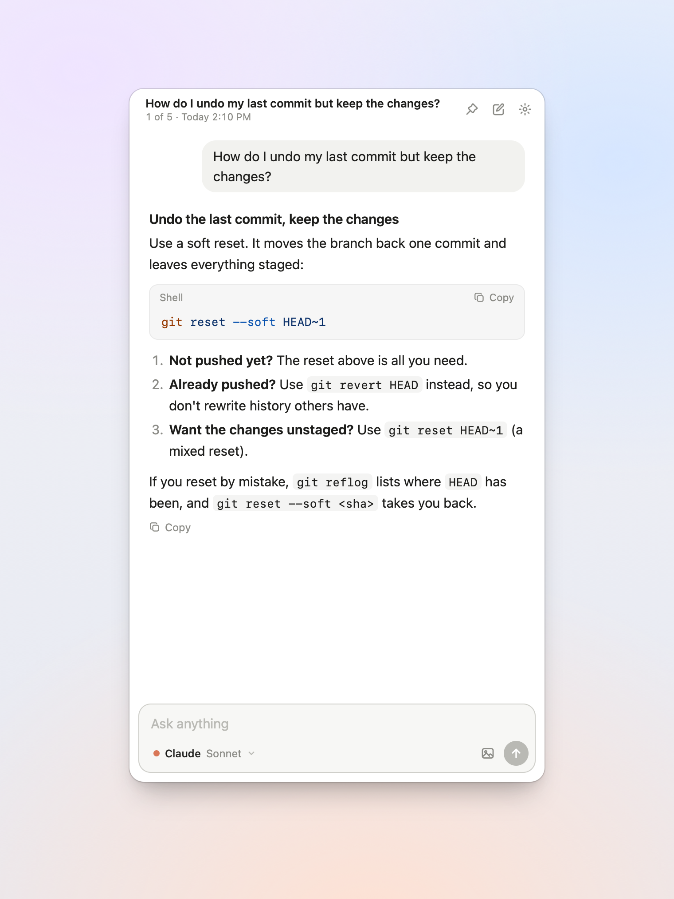
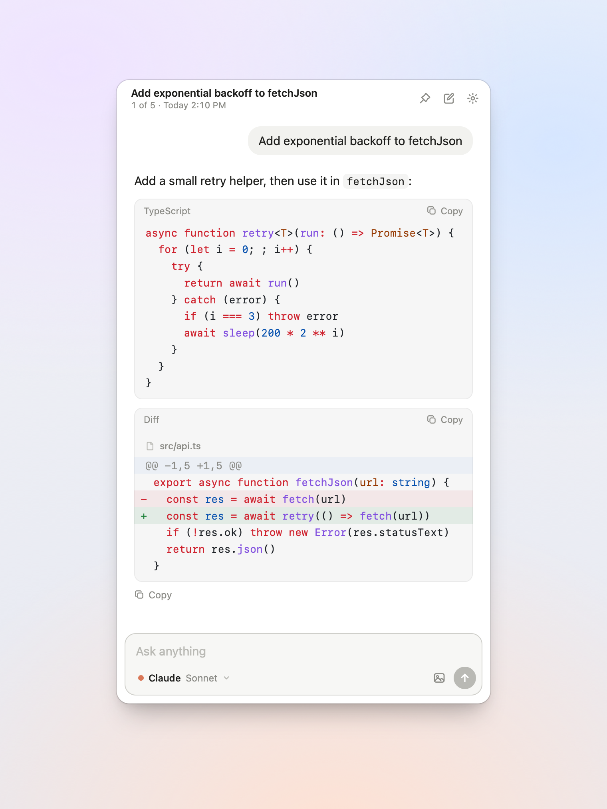
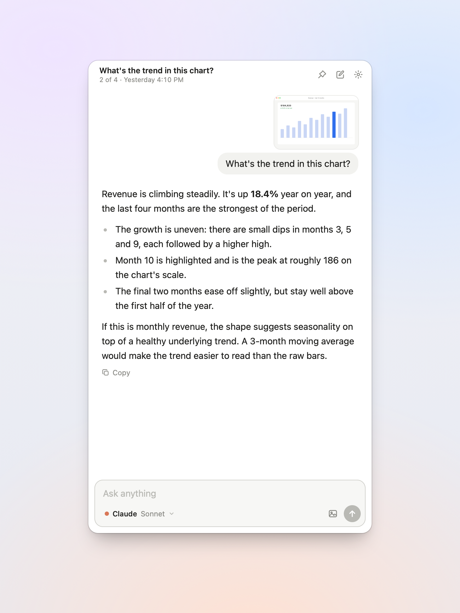
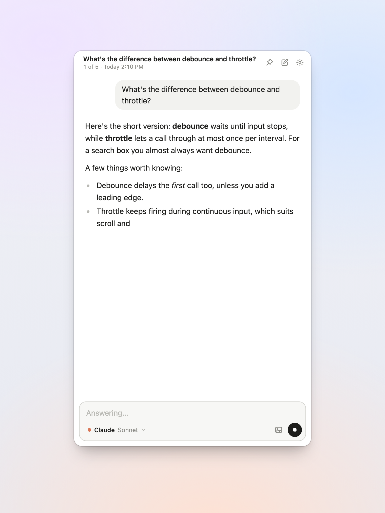
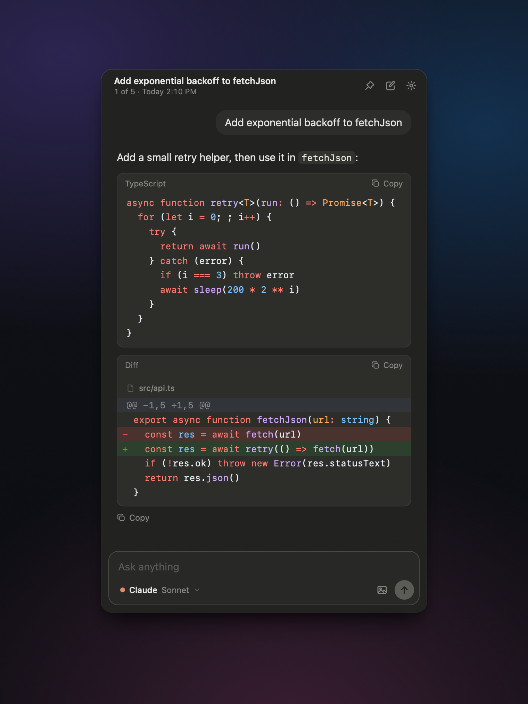
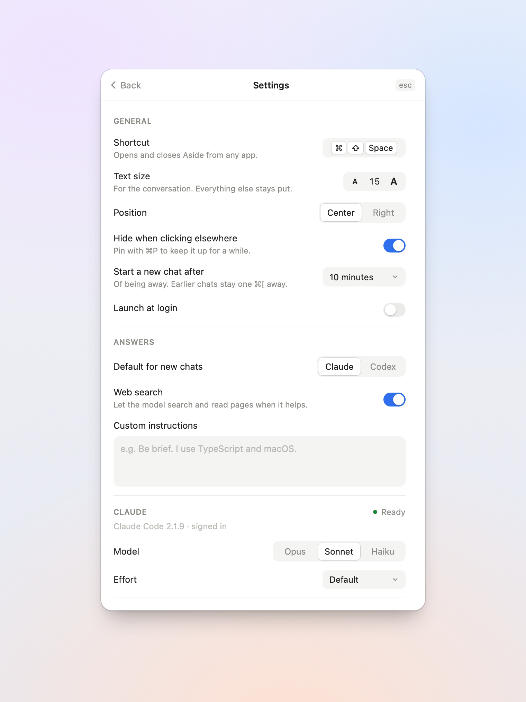

# Aside

A small chat panel for your Mac that runs on the Claude Code and Codex subscriptions you already pay for.

Press a shortcut and a tall, narrow panel opens over whatever app you're in. Type a question, paste a screenshot, and the answer streams in. Press the shortcut again, or click back into your app, and the panel goes away.



## Why

Opening a full Claude or ChatGPT window for a quick question is heavy, and asking through `claude` or `codex` in a terminal fills your session history with throwaway chats. Aside runs the same CLIs you're already signed in to, with no API keys, and keeps its conversations in a separate folder.

## What it does

- **Opens over anything.** It's a non-activating floating panel, like Spotlight. It doesn't take a Dock slot, pull you out of full-screen apps or switch Spaces. It opens on the screen your pointer is on.
- **Streams smoothly.** Text is revealed at an even pace instead of in network-sized chunks. Markdown is parsed block by block, so a long answer doesn't slow down as it grows. The view follows the bottom until you scroll up.
- **Takes images.** Paste a screenshot (⌃⇧⌘4, then ⌘V), drop files on the panel, or pick them with the attach button. Images are downscaled before they're sent.
- **Highlights code.** Code is highlighted with Shiki in a Web Worker, so it never blocks streaming. Diffs show added and removed lines in green and red, with each line highlighted in its own language.
- **Starts fresh after a break.** After 10 minutes away (you can change this), the panel opens to a clean slate. ⌘[ and ⌘] step back through earlier conversations.
- **Uses Claude and Codex.** Choose the default provider, model and effort for each in Settings. ⌘/ switches the current chat to the other one.
- **Keeps transcripts separate.** Aside never writes to Claude Code's or Codex's session history. Each conversation is a JSON file in Aside's own folder.

<p>
  
  
</p>
<p>
  
  
</p>

## Requirements

- macOS 13 or later.
- At least one of these CLIs, installed and signed in:
  - [Claude Code](https://docs.anthropic.com/en/docs/claude-code): `npm i -g @anthropic-ai/claude-code`, then run `claude` once to sign in.
  - [Codex](https://github.com/openai/codex): `npm i -g @openai/codex`, then `codex login`.

Aside finds the CLIs in the usual install locations (Homebrew, `~/.local/bin`, npm, bun, volta), or through your login shell's `PATH`. Settings shows whether each one is ready.

## Install

Download `Aside-<version>-arm64.zip` from the [latest release](https://github.com/AmoabaKelvin/aside/releases/latest), unzip it and move `Aside.app` to `/Applications`. Builds are for Apple Silicon only.

The app is signed but not notarized, so the first time you open it macOS says it can't verify the developer. Right-click `Aside.app` and choose **Open**, or allow it under System Settings → Privacy & Security. You can also clear the quarantine flag yourself:

```sh
xattr -dr com.apple.quarantine /Applications/Aside.app
```

Aside lives in the menu bar. The default shortcut is **⌘⇧Space**. You can change it in Settings, for example to ⌥Space.

### Build from source

You need [Rust](https://rustup.rs), Node 20+ and [pnpm](https://pnpm.io).

```sh
git clone https://github.com/AmoabaKelvin/aside.git
cd aside
pnpm install
pnpm app:build
cp -R src-tauri/target/release/bundle/macos/Aside.app /Applications/
```

To sign the build with your own certificate, set `APPLE_SIGNING_IDENTITY` before running `pnpm app:build`.

## Keyboard

| Key | Action |
| --- | --- |
| `↵` / `⇧↵` | Send / new line |
| `Esc` | Close the image viewer or Settings, otherwise hide the panel |
| `⌘[` / `⌘]` | Previous (older) / next (newer) conversation |
| `⌘N` | New chat |
| `⌘.` | Stop the answer |
| `⌘/` | Switch this chat between Claude and Codex |
| `⌘⇧C` | Copy the last answer |
| `⌘P` | Pin the panel so it stays up when you click elsewhere |
| `⌘,` | Settings |

## Settings



- **General:** shortcut, text size, position (centred, or on the right edge), hide when you click elsewhere, how long until a new chat starts, launch at login.
- **Answers:** default provider, web search on or off, and extra instructions added to every chat.
- **Claude / Codex:** model and effort for each.
- **Transcripts:** reveal the folder in Finder.

## How it works

Aside is a [Tauri 2](https://tauri.app) app. The UI is React and the backend is Rust.

- **Claude** runs as `claude -p` with `--input-format stream-json`, one process per conversation. The process is kept alive between turns, so follow-up questions don't pay the startup cost. A spare process is started ahead of time for the next new chat, and idle processes are stopped after about 10 minutes. `--no-session-persistence` keeps these chats out of Claude Code's history. The only tools allowed are web search and page fetch, or none at all if you turn web search off. Your MCP servers and Claude settings aren't loaded.
- **Codex** runs as `codex app-server` over JSON-RPC. Threads are ephemeral, the sandbox is read-only, and hooks, notifications and MCP servers are off.
- **The panel** is an `NSPanel` (via [tauri-nspanel](https://github.com/ahkohd/tauri-nspanel)), created hidden at launch and reused, so showing it is instant.

Everything Aside saves is in `~/Library/Application Support/com.kelvinamoaba.aside/`:

```
settings.json
conversations/<YYYYMMDD-HHMMSS-xxxx>.json
images/<sha256>.png
```

The full window, event and command contract is in [docs/contract.md](docs/contract.md).

## Development

```sh
pnpm app        # run the app with hot reload
pnpm dev        # UI only, in a browser, with a mock backend
pnpm typecheck
cd src-tauri && cargo test
```

`pnpm dev` swaps the Rust side for `src/lib/mock.ts`, so you can work on the UI in a regular browser.

## License

[MIT](LICENSE)
